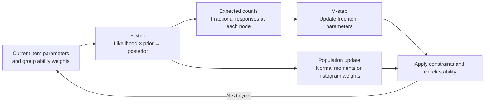

# Make MMLE–EM visible across calibration methods

Build an **MMLE–EM Learning Lab** with four calibration designs and a separate ability-distribution choice. The designs are standard single-group estimation, concurrent calibration, fixed-bank-anchor calibration, and concurrent calibration with fixed bank anchors. **Empirical histogram estimation belongs beside the normal distribution option**, so learners can explore it across calibration designs. The existing MHRM app supplies the sidebar, numbered teaching steps, replay controls, and interpretation boxes; all computation and algorithm visuals change to MMLE–EM. Use a **six-tab layout with dedicated Validation**, with **irtQ endpoint agreement as the primary reference criterion**, supplemented by recovery, constraints, and sensitivity. Include explicit **response-generation controls** and an **Equation / Explanation / Notation** layer throughout the walkthrough. Teach unidimensional 2PL first and include an explicit **3PL a/b/c M-step and configurable item-prior lesson** in the planned scope; release each model only after validation. The proposal below is informed by irtQ’s official documentation and GitHub source; it is a design, not an implemented or numerically validated app. ([Package overview](https://hwangq.github.io/irtQ/))

## Four calibration designs share one learning framework

The first screen should answer three questions: **Which items are estimated? What is shared across groups? What fixes the ability scale?** Its method selector follows this matrix.

| Calibration design | Item treatment | Scale source | Normal ability model | Empirical histogram |
|---|---|---|---|---|
| Standard MMLE–EM | Estimate item parameters for one group | Fixed population mean and variance | Fixed moments | Update shape; rescale to fixed moments |
| Concurrent calibration | Estimate common items jointly and unique items individually | Reference-group distribution | Reference moments fixed; other groups estimated | Reference shape updates with rescaling; free groups update without rescaling |
| Fixed-anchor calibration | Hold bank anchors fixed; estimate new items | Supplied bank coefficients | Estimate population moments | Update weights without moment rescaling |
| Fixed anchors + concurrent | Hold bank anchors fixed; jointly estimate remaining common items and estimate unique items | Bank scale, transmitted through item connections | Usually estimate every group’s moments | Usually update every group’s weights without rescaling |

irtQ directly supports the combined design as multiple-group fixed item parameter calibration. It is more than fitting groups independently and linking them afterward. Items with the same ID share one coefficient set; fixing an item in one group fixes that item wherever it appears. The interface should distinguish **Common item—estimated jointly** from **Bank anchor—held fixed**. A bank anchor need not appear on every form when common-item connections transmit its scale. ([Multiple-group reference](https://hwangq.github.io/irtQ/reference/est_mg.html), [item-sharing and anchor source](https://github.com/hwangQ/irtQ/blob/5ad30cd2aa3a7e6a74964df3162e70b0352e7ebc/R/est_mg.R#L218-L277))

Before estimation, display a group-by-item administration map. Each cell reads **Unique/free**, **Common/shared**, **Bank/fixed**, or **Not administered**, using labels as well as color. Beside it, an item table shows model, category count, fixed values, and participating groups; a group table shows initial ability distribution, fixed/free moments, and scale source. Use whole-item locks in the initial scope, matching the general irtQ interface. Arbitrary coefficient-specific partial anchors should be a separately identified future extension. ([Constraint options](https://hwangq.github.io/irtQ/reference/est_mg.html))

The design checker rejects conflicting bank values, inconsistent same-ID models/categories, invalid scores, and disconnected groups without a reference or bank-scale connection. Connectivity is necessary but does not prove identification or adequate information. The screen should explain the specific missing connection or constraint so the learner can repair the design.

## Response generation separates known truth from fitting assumptions

The Design tab and sidebar **Response generation** panel expose the following controls. These define the data-generating experiment, independently of estimation priors and starting values.

| Control | Proposed behavior |
|---|---|
| Generating IRT model | Unidimensional 2PL first, with planned 3PL a/b/c generation; other documented models after validation |
| Group and form design | People per group, item/form counts, group-to-form assignments, and common/unique/fixed-bank item map |
| True item parameters | Editable a/b table, plus true guessing c values/ranges for 3PL, or reproducible draws from selected ranges/distributions; show the resulting values before generation |
| True ability distribution | Group-specific normal mean/SD; skewed and bimodal presets; optional custom node locations and normalized masses |
| Logistic scale | Explicit positive scaling constant, carried into generation, fitting, and irtQ comparison |
| Missingness | Optional response-missingness rate/pattern, separate from items absent from a form |
| Reproducibility | Fixed seed and saved generation settings; **Generate responses**, then explicit **Regenerate** |

For each person, the generator draws a true ability, computes administered-item probabilities, and samples responses. The initial **2PL** lesson uses:

\[
\theta_{ig}^{\mathrm{true}}\sim f_g^{\mathrm{true}},\qquad
p_{igj}^{\mathrm{true,2PL}}=
\operatorname{logistic}\!\left[D a_j^{\mathrm{true}}(\theta_{ig}^{\mathrm{true}}-b_j^{\mathrm{true}})\right].
\]

The **3PL** generation lesson adds the true guessing coefficient:

\[
p_{igj}^{\mathrm{true,3PL}}=
c_j^{\mathrm{true}}+(1-c_j^{\mathrm{true}})
\operatorname{logistic}\!\left[D a_j^{\mathrm{true}}(\theta_{ig}^{\mathrm{true}}-b_j^{\mathrm{true}})\right],
\qquad
Y_{igj}\mid\theta_{ig}^{\mathrm{true}}\sim\mathrm{Bernoulli}(p_{igj}^{\mathrm{true}}).
\]

Here \(p^{\mathrm{true}}\) in the Bernoulli draw is the probability from the selected generating model; 2PL fixes \(c^{\mathrm{true}}=0\).

**Explanation:** ability and item truth determine a probability, then random sampling determines a realized correct/incorrect response. Theoretical probabilities and realized proportions need separate labels. Generate responses only for administered items; apply any optional missingness afterward, preserving both masks. Neither missing nor unadministered becomes an incorrect answer automatically.

The default teaching dataset remains **1,000 people, 20 items, 2PL, normal ability with mean 0 and SD 1, and logistic scale \(D=1\)**. A proposed generation preset could draw positive discriminations from Uniform(0.5, 2) and difficulties from Uniform(−2, 2); these are app-design choices, not claimed irtQ defaults. Fitting defaults use no item priors. An explicit mismatch lesson can generate a skewed population while fitting normal weights; changing that fitted assumption reuses the exact same responses.

Show **true bank-item parameters** and **supplied anchor coefficients** separately. They match in the ordinary preset. An optional **Anchor drift demonstration** deliberately changes one relative to the other, displays the discrepancy, and preserves both tables. It must never silently perturb an anchor. Preview true group ability histograms, true item curves/parameters, a response heatmap, score/proportion-correct summaries, and the administration map. Require positive generating discriminations/SDs, valid parameter ranges (including true 3PL c in [0,1)), finite nodes, and nonnegative custom masses summing to one. Check necessary scale connections without declaring connectivity sufficient for identification.

Export observed responses, group/form and administration maps, simulation truth, and generation settings/seed. Store the generated response matrix once so method comparisons do not resimulate on each fit. Upload mode disables generation-only truth controls; no multidimensional correlation settings are included in this unidimensional scope.

## The screen centers on one complete EM cycle

Use the title **MMLE–EM Learning Lab**, a short current-experiment description, and a **Guided / Explore** switch. Both levels use the same estimator; Guided reduces controls and reveals the lesson progressively. The persistent sidebar holds experiment-wide settings, including an expandable **Response generation** panel and a separate **Generate / Regenerate responses** action. Group, item, person, cycle, and playback selectors stay beside the charts they affect.

| Main tab | Primary content | Learner’s question |
|---|---|---|
| Design | Response generation/upload, model, administration map, item/group constraints | Which responses were generated, what is estimated, and on which scale? |
| EM walkthrough | Synchronized E-step, expected counts, M-step, distribution update | How does one cycle change the model? |
| Results | Estimates, trajectories, distributions, convergence, recovery | What did the run recover, and what remains uncertain? |
| Validation | R agreement, simulation recovery, invariants, sensitivity, reproducible check report | Which results have actually been checked, and how? |
| Compare | Saved experiments under different assumptions | What changes when one assumption changes? |
| Method notes | Equations, parameterization, constraints, glossary | Why does this method work? |

Keep numbered sections and short **What changed / Why / What to watch** boxes from the reference app. Provide a useful bundled example immediately, before the first Run click; label it **Not validated** until its checks have actually been executed. Generation creates a saved dataset; estimation and playback reuse it. Display-only changes reuse recorded results; changed estimation settings show a pending-settings notice until Run. Regenerating responses creates a new dataset and a new comparison baseline.

The **EM walkthrough** has one cycle slider plus Previous, Next, Play/Pause, Restart, speed, **Run one cycle**, and **Run to stopping rule**. Playback visits the following synchronized views.

**Current model:** show the selected item’s response curve and the selected group’s quadrature weights. Distinguish starting, current, and bank-fixed coefficients. **E-step:** select a person or response pattern and show likelihood over ability, population prior weights, and normalized posterior weights. Show explicitly that posterior weights sum to one. **Expected counts:** aggregate those posterior contributions into expected respondents and correct/category responses at each node. These are fractional counts, not observed ability bins. Exclude missing or unadministered responses from that item’s exposure. ([E-step source](https://github.com/hwangQ/irtQ/blob/5ad30cd2aa3a7e6a74964df3162e70b0352e7ebc/R/EM.R#L34-L73))

**M-step:** overlay old and updated item curves, show coefficient changes and the expected objective, and keep bank anchors visibly locked. For a shared item, show how expected counts combine across the groups that administered it. **Population update:** show initial weights, posterior-average weights, and weights used next cycle after any required scale adjustment. **Cycle check:** show the full updated-state marginal likelihood, item changes, distribution changes, and optimizer status. Exact equations and tables belong in expanders. An optimizer path appears only if the implementation actually records one.

## Two playback modes animate recorded E-steps and convergence

The walkthrough explicitly includes **E-step playback** and **Convergence playback**. Both are planned app functionality; the supplied image is a static design preview and no functioning animation has been implemented.

**E-step playback** selects a group and person/response pattern, then steps through that cycle’s actual likelihood at the quadrature nodes, multiplication by the current group population masses, normalization into posterior masses summing to one, and fractional contributions to expected counts. Pause/manual stepping makes the selected person’s posterior distinct from the subsequent group-population update. Labels show the E-step input state \(\boldsymbol\psi^{(t)}\), posterior \(\tau^{(t)}\), and resulting M-step state \(\boldsymbol\psi^{(t+1)}\). Each numerical state comes from saved E-step data or is reconstructed deterministically from its saved inputs and original responses—not from final estimates or invented intermediate values.

**Convergence playback** synchronizes recorded old/new item curves and coefficient trajectories, group normal moments or histogram weights, the appropriately labeled raw likelihood or penalized objective, item/density changes, and stopping status. Fixed anchors remain locked. A shared item has one trajectory, with its group-specific expected-count contributions inspectable. Selecting a group changes its distribution views without inventing separate estimates for a common item.

Both modes offer **Play/Pause, Restart, Previous/Next, cycle scrubbing, speed, all cycles/selected range, item and group selectors**. Replaying, resuming, or changing the selection reuses saved results without refitting or regenerating responses. Retain cycle-indexed item coefficients, E-step input weights/likelihood state, expected counts, post-update distributions, objective values, optimizer/stopping diagnostics, and constraints. If visual interpolation smooths a transition, label it as display interpolation; only recorded states are estimates. Final-value-only irtQ outputs validate endpoints and cannot recreate R iteration histories.

Planned validation checks compare displayed animation values against stored histories, verify posterior normalization and expected-count/exposure conservation, preserve locked anchors, and check synchronized cycle labels across panels. Provide keyboard/manual stepping, reduced-motion behavior, static tables, and history export. These animation checks start **Not run** until implemented and executed.

## Prior controls explain timing and scale constraints

The sidebar should separate **Population ability distribution** from **Item parameter priors**. The population panel chooses Normal or Empirical histogram, initial values, and fixed/free group moments permitted by the design. Standard histogram estimation updates shape while retaining the scale through rescaling; anchored estimation allows the population’s moments to move on the bank scale. Show these constraints beside the evolving density rather than burying them in settings. ([Distribution-update source](https://github.com/hwangQ/irtQ/blob/5ad30cd2aa3a7e6a74964df3162e70b0352e7ebc/R/EM.R#L301-L452))

For anchored methods, provide two documented schedules. **OEM—one cycle:** calculate posteriors from fixed-item responses under the initial population weights and fit new items once. The returned population distribution is updated afterward, but it is not fed back into another item-fitting cycle. **MEM—iterative updates:** use fixed-item responses in the first E-step, then all administered items from cycle two onward; update free items and population weights repeatedly. Playback should highlight which items inform each E-step. OEM must say **One cycle completed**, rather than imply ordinary iterative convergence. ([Single-group schedules](https://github.com/hwangQ/irtQ/blob/5ad30cd2aa3a7e6a74964df3162e70b0352e7ebc/R/est_irt.R#L315-L340), [multiple-group schedules](https://github.com/hwangQ/irtQ/blob/5ad30cd2aa3a7e6a74964df3162e70b0352e7ebc/R/est_mg.R#L301-L318))

Item-prior switches concern discrimination, difficulty, and guessing coefficients. **No item priors** gives the pure-MMLE teaching preset; enabling them changes the target to a marginal posterior mode, labeled **Bayes modal**. irtQ enables a guessing prior by default, so the reference configuration must explicitly disable it when demonstrating pure MMLE. Show the penalized objective separately from raw marginal likelihood when priors are enabled. Update-every-several-cycles, smoothing, damping, or freeze-after-cycle controls are possible educational extensions, not verified native irtQ options. ([Item-prior documentation](https://hwangq.github.io/irtQ/reference/est_irt.html))

Suggested starting controls are **2PL; one group; normal mean 0 and SD 1; no item priors; 1,000 people; 20 items; fixed seed**. Advanced controls expose starting coefficients, quadrature grid, maximum cycles, item tolerance, numerical optimization, and reference settings. An irtQ-matched numerical preset uses its documented 49 nodes spanning −6 to 6, 500 maximum EM cycles, and item-change tolerance 0.0001. These are reference defaults, not guarantees of numerical adequacy. The planned 3PL lesson adds guessing controls and per-a/b/c equations; add 1PL/Rasch, GRM, and GPCM after their validation; distinguish a fixed Rasch slope from a common estimated 1PL slope. irtQ’s scope is unidimensional. ([Estimator options](https://hwangq.github.io/irtQ/reference/est_irt.html))

## Equations explain the same quantities shown in the charts

Each walkthrough phase offers **Equation / Explanation / Notation**. Guided view keeps one relevant equation and its plain-language meaning visible; derivations expand on demand. Selecting a symbol highlights its definition and corresponding chart/table. Method notes retain the complete notation and derivation. The first lesson uses binary 2PL; later models replace the response-probability and category-count terms.

| Symbol | Meaning |
|---|---|
| \(g=1,\ldots,G\), \(i=1,\ldots,n_g\) | Group and person within group; \(n_g\) is group size |
| \(j=1,\ldots,J\), \(q=1,\ldots,Q\) | Global item ID and quadrature-node index |
| \(y_{igj}\in\{0,1\}\) | Observed incorrect/correct response |
| \(A_{igj},O_{igj}\), \(m_{igj}=A_{igj}O_{igj}\) | Administered indicator, observed indicator, and combined response mask |
| \(\theta_{ig}\), \(x_q\) | Person’s unobserved scalar ability and a fixed integration node |
| \(w_{gq}\ge0,\ \sum_qw_{gq}=1\) | Current population probability mass at node \(q\) in group \(g\) |
| \(a_j,b_j\in\mathbb R,\ D>0\) | Fitted discrimination/difficulty and logistic scaling; reference-compatible fitting leaves a/b unbounded; **\(D\) is not a dimension count** |
| \(c_j\in[0,1)\) | 3PL lower-asymptote/guessing coefficient; fixed at zero in 2PL |
| \(t\), \(\boldsymbol\beta\), \(\boldsymbol\psi^{(t)}\) | Cycle, all item coefficients, and current item/distribution state |
| \(\tau_{igq}^{(t)}\), \(N_{jgq}^{(t)},R_{jgq}^{(t)}\) | Posterior ability mass; expected exposed and correct counts |
| \(\mu_g,\sigma_g^2\), \(\mathcal A\) | Population mean/variance and set of fixed bank anchors |

**Current model—response probability.**

\[
P_j(\theta)=\operatorname{logistic}\!\left[D a_j(\theta-b_j)\right]
=\frac{1}{1+\exp\{-D a_j(\theta-b_j)\}}.
\]

For nonzero \(a_j\), the curve crosses 50% at \(\theta=b_j\). In the guided positive-a lesson, larger \(a_j\) gives a steeper curve for fixed \(D\). If another implementation uses slope/intercept, map exactly to \(\alpha_j=D a_j\), \(\delta_j=-D a_jb_j\), so \(\alpha_j\theta+\delta_j=D a_j(\theta-b_j)\). The irtQ validation adapter must compare the same parameterization and logistic scaling. ([Response-model documentation](https://hwangq.github.io/irtQ/reference/est_irt.html))

**E-step—likelihood, marginalization, and posterior.** At the current cycle,

\[
L_{igq}^{(t)}=
\prod_{j:m_{igj}=1}
 P_j(x_q;\boldsymbol\beta^{(t)})^{y_{igj}}
 [1-P_j(x_q;\boldsymbol\beta^{(t)})]^{1-y_{igj}},
\qquad
\ell(\boldsymbol\psi^{(t)})=
\sum_g\sum_i\log\!\left[\sum_q w_{gq}^{(t)}L_{igq}^{(t)}\right].
\]

\[
\tau_{igq}^{(t)}=
\frac{w_{gq}^{(t)}L_{igq}^{(t)}}
{\sum_r w_{gr}^{(t)}L_{igr}^{(t)}},
\qquad \sum_q\tau_{igq}^{(t)}=1.
\]

Multiply only observed/administered response terms. Marginalization averages the person’s likelihood across possible abilities; Bayes normalization converts weighted likelihood into that person’s posterior masses. Show these three quantities in the likelihood/prior/posterior panels. Compute products and sums stably in log space. ([E-step implementation](https://github.com/hwangQ/irtQ/blob/5ad30cd2aa3a7e6a74964df3162e70b0352e7ebc/R/EM.R#L34-L73))

**Expected counts—fractional contributions.**

\[
N_{jgq}^{(t)}=\sum_i m_{igj}\tau_{igq}^{(t)},\qquad
R_{jgq}^{(t)}=\sum_{i:m_{igj}=1} y_{igj}\tau_{igq}^{(t)}.
\]

Each observed person contributes a fraction to every node. \(N\) is expected exposure and \(R\) expected correct responses; evaluate missing values only through the explicit mask, never as zero responses. The selected-item count table shows \(0\le R\le N\), with total exposure matching observed administrations.

**Item M-step—fit curves to expected counts.**

\[
\mathcal Q_{\mathrm{item}}(\boldsymbol\beta\mid\boldsymbol\psi^{(t)})=
\sum_j\sum_g\sum_q
\left[R_{jgq}^{(t)}\log P_j(x_q;\boldsymbol\beta)
 +(N_{jgq}^{(t)}-R_{jgq}^{(t)})\log(1-P_j(x_q;\boldsymbol\beta))\right],
\]

\[
\boldsymbol\beta^{(t+1)}
\approx \arg\max_{\boldsymbol\beta\in\mathcal C}
\mathcal Q_{\mathrm{item}}(\boldsymbol\beta\mid\boldsymbol\psi^{(t)}).
\]

The constraint set \(\mathcal C\) enforces model restrictions, the selected reference-compatible fitting bounds by default, and \((a_j,b_j)=(a_j^{\mathrm{bank}},b_j^{\mathrm{bank}})\) for \(j\in\mathcal A\). A common item uses one \((a_j,b_j)\) across groups, so its expected counts pool across groups. The approximation symbol acknowledges numerical optimization. Show actual before/after objectives and curves; show optimizer movement only if recorded. With item priors, optimize \(\mathcal Q_{\mathrm{item}}+\sum_j\log\pi_j(\boldsymbol\beta_j)\) over the relevant free coefficients and label **Bayes modal**. The population weights \(w\) are not these item priors. ([M-step implementation](https://github.com/hwangQ/irtQ/blob/5ad30cd2aa3a7e6a74964df3162e70b0352e7ebc/R/EM.R#L106-L290))

**Population update—histogram shape or normal moments.**

\[
\widetilde w_{gq}^{(t+1)}=\frac{1}{n_g}\sum_i\tau_{igq}^{(t)}.
\]

These are raw posterior-average histogram masses. A free bank-scale group uses them directly in empirical-histogram mode. An ordinary/reference group applies the reference’s rescaling/interpolation operation to retain its specified mean and variance; show raw versus actually used masses. The grid remains fixed, and interpolation can leave small numerical moment discrepancies. Standard fixed-normal calibration retains its original weights.

For a group whose normal moments are estimated, display the reference’s **moment-based update rule**:

\[
\mu_g^{(t+1)}=\sum_q\widetilde w_{gq}^{(t+1)}x_q,\qquad
(\sigma_g^2)^{(t+1)}=
\sum_q\widetilde w_{gq}^{(t+1)}(x_q-\mu_g^{(t+1)})^2.
\]

On the equally spaced reference grid, regenerate normalized normal masses proportional to the normal density with these moments. Do not call this a universal exact maximization of a discretized Gaussian-weight objective. Ordinary/reference moments stay fixed; bank anchors permit free distributions to move on their scale. For anchored OEM, restrict the initial likelihood product to observed fixed-bank items, fit new items once, and show the returned distribution update without another feedback cycle. MEM also starts with fixed items, then uses all observed/administered items from cycle two onward. ([Density-update implementation](https://github.com/hwangQ/irtQ/blob/5ad30cd2aa3a7e6a74964df3162e70b0352e7ebc/R/EM.R#L301-L452), [anchor schedules](https://hwangq.github.io/irtQ/reference/est_irt.html))

**Cycle check and reference agreement—different questions.**

\[
\Delta_{\mathrm{item}}^{(t)}=
\max_{k\in\mathrm{free}}|\beta_k^{(t+1)}-\beta_k^{(t)}|,
\qquad
\Delta_w^{(t)}=\max_{g,q}|w_{gq}^{(t+1)}-w_{gq}^{(t)}|.
\]

Show population mean/SD changes separately, alongside likelihood, stop reason, and optimizer status. These measure within-run stability. The primary irtQ endpoint check instead uses declared tolerances by parameter type \(k\):

\[
|\widehat\beta_{jk}^{\mathrm{Python}}-\widehat\beta_{jk}^{\mathrm{irtQ}}|
\le \operatorname{atol}_k+
\operatorname{rtol}_k|\widehat\beta_{jk}^{\mathrm{irtQ}}|.
\]

Explain absolute allowance near zero and relative allowance as magnitude grows; establish documented tolerance presets during implementation baseline checks, not arbitrary universal cutoffs. Keep curve/density/likelihood comparison criteria explicit too. Stability, agreement with irtQ, and recovery of simulation truth remain distinct. The earlier objective/monotonicity caveats apply to these equations and the displayed traces.

## The 3PL lesson exposes each a, b, and c M-step equation

For 3PL, let \(c_j\) denote the guessing coefficient, called \(g_j\) in irtQ. At each quadrature node,

\[
s_{jq}=\operatorname{logistic}[D a_j(x_q-b_j)],\qquad
p_{jq}=c_j+(1-c_j)s_{jq}.
\]

The expected counts \(N_{jgq}^{(t)},R_{jgq}^{(t)}\) from the E-step stay **fixed throughout this item M-step**. The candidate \(a,b,c\) values change \(p\). For item \(j\), maximize

\[
\mathcal Q_j(a_j,b_j,c_j)=\sum_{g,q}\left[
R_{jgq}^{(t)}\log p_{jq}+
(N_{jgq}^{(t)}-R_{jgq}^{(t)})\log(1-p_{jq})\right].
\]

Define \(e_{jgq}=R_{jgq}^{(t)}-N_{jgq}^{(t)}p_{jq}\). The general score rule is

\[
S_{v_j}=\frac{\partial\mathcal Q_j}{\partial v_j}
=\sum_{g,q}\frac{e_{jgq}}{p_{jq}(1-p_{jq})}
\frac{\partial p_{jq}}{\partial v_j}.
\]

The three probability derivatives are

\[
\frac{\partial p}{\partial a}=(1-c)D(x-b)s(1-s),\quad
\frac{\partial p}{\partial b}=-(1-c)Da\,s(1-s),\quad
\frac{\partial p}{\partial c}=1-s.
\]

Therefore the **separate a, b, and c score equations** are

\[
\boxed{S_{a_j}=\sum_{g,q}D(x_q-b_j)s_{jq}\frac{e_{jgq}}{p_{jq}}},\qquad
\boxed{S_{b_j}=-\sum_{g,q}D a_j s_{jq}\frac{e_{jgq}}{p_{jq}}},
\]
\[
\boxed{S_{c_j}=\sum_{g,q}\frac{e_{jgq}}{p_{jq}(1-c_j)}}.
\]

The a equation adjusts steepness according to the node’s distance from difficulty; the b equation moves curve location; the c equation adjusts the lower asymptote. They are **coupled numerical optimization equations**, not independent closed-form coefficient updates. At an interior unpenalized optimum, all free scores are zero. At a constrained boundary, use the appropriate constrained optimum conditions instead. A common item shares one a/b/c set across groups; bank-fixed coefficients never update. Fixing \(c=0\) reduces the a/b scores to their 2PL forms and removes the c equation entirely. irtQ also optimizes the direct item coefficients numerically. ([Reference item objective](https://github.com/hwangQ/irtQ/blob/5ad30cd2aa3a7e6a74964df3162e70b0352e7ebc/R/loglike_item.R#L193-L225))

### Users choose item priors in a dedicated control panel

Expose **Pure MMLE—all item priors off**, **Reset to irtQ defaults**, and independent **Enable**, **Family**, and **Hyperparameter** controls for each free coefficient. Start with curated, interpretable choices: Lognormal for a, optional Normal for b, and Beta for c. The c panel is available only for free 3PL guessing coefficients; it is disabled for 2PL and bank anchors. Advanced alternatives use irtQ-supported Normal/Lognormal/Beta families only after checking support, parameterization, and reference compatibility. Do not present nonsensical family/support combinations in Guided mode.

| Coefficient | Reference-supported teaching prior | User-controlled hyperparameters | Verified irtQ reset |
|---|---|---|---|
| a | Lognormal on the scaled slope \(z_j=D a_j\) | Log mean \(\mu_a\), positive log SD \(\sigma_a\) | Disabled; \(\mu_a=0,\sigma_a=0.5\) |
| b | Optional Normal | Mean \(\mu_b\), positive SD \(\sigma_b\) | Disabled; \(\mu_b=0,\sigma_b=1\) |
| c | Beta on \((0,1)\) | Positive shape parameters \(\alpha_c,\beta_c\) | Enabled; \(\alpha_c=5,\beta_c=16\), when c is freely estimated |

These are verified package defaults, distinct from the app’s pure-MMLE preset. **irtQ evaluates the slope prior at \(D a\)**, so controls and validation must show that scale. A direct prior on a is a different choice when \(D\ne1\). The density on a induced by the reference choice is \(D f_Z(Da)\); the factor D is constant during optimization. Show implied mean, spread, and quantiles on both the selected prior scale and the actual coefficient scale. ([Prior options/defaults](https://github.com/hwangQ/irtQ/blob/5ad30cd2aa3a7e6a74964df3162e70b0352e7ebc/R/est_irt.R#L73-L98), [prior evaluation](https://github.com/hwangQ/irtQ/blob/5ad30cd2aa3a7e6a74964df3162e70b0352e7ebc/R/logprior_deriv.R#L1-L18), [item objective](https://github.com/hwangQ/irtQ/blob/5ad30cd2aa3a7e6a74964df3162e70b0352e7ebc/R/loglike_item.R#L193-L225))

For the curated families, the log-prior terms, up to coefficient-independent constants, are

\[
\log\pi_a(a)=-\log(Da)-\frac{[\log(Da)-\mu_a]^2}{2\sigma_a^2},\quad
\log\pi_b(b)=-\frac{(b-\mu_b)^2}{2\sigma_b^2},
\]
\[
\log\pi_c(c)=(\alpha_c-1)\log c+(\beta_c-1)\log(1-c).
\]

With enabled-prior indicators \(I_a,I_b,I_c\), optimize

\[
\mathcal Q_j^{\mathrm{pen}}=\mathcal Q_j+
I_a\log\pi_a+I_b\log\pi_b+I_c\log\pi_c.
\]

The corresponding **prior-adjusted score equations** are

\[
S_{a_j}^{\mathrm{pen}}=S_{a_j}
-I_a\frac{1+[\log(Da_j)-\mu_a]/\sigma_a^2}{a_j}=0,
\]
\[
S_{b_j}^{\mathrm{pen}}=S_{b_j}
-I_b\frac{b_j-\mu_b}{\sigma_b^2}=0,\qquad
S_{c_j}^{\mathrm{pen}}=S_{c_j}
+I_c\left[\frac{\alpha_c-1}{c_j}-\frac{\beta_c-1}{1-c_j}\right]=0.
\]

These zero equations apply only to free, interior optima; omit terms for disabled priors and omit locked coefficients from optimization. At \(D=1\), the a expression simplifies to the ordinary direct-a lognormal score. irtQ works in direct a/b/c coefficients, without a log/logit optimizer transformation or Jacobian. A proposed Python optimizer must preserve this same original-scale objective; adding an unintended transformation Jacobian changes the MAP target. ([Prior derivatives](https://github.com/hwangQ/irtQ/blob/5ad30cd2aa3a7e6a74964df3162e70b0352e7ebc/R/logprior_deriv.R#L1-L18))

The panel previews the prior density and implied mean/SD/quantiles live as users edit. During the M-step, allow inspection of relative expected likelihood, log-prior contribution, and penalized objective, clearly labeling differing scales; retain raw marginal likelihood separately. Default scope is all relevant free items. Applying different priors to selected free items is a proposed extension requiring its own implementation and reference strategy, not claimed native irtQ scope. Anchor controls remain locked. Distinguish these priors from true generating a/b/c distributions, population ability weights, and initialization. Editing priors creates **pending fit settings** and requires a new fit on saved responses; it does not redraw an existing animation as if refitted.

**Default fitting bounds match irtQ:** a/b are unbounded; free 3PL c lies in \([10^{-8},1-10^{-8}]\); 2PL c is fixed at zero. Guided generation and starting values use positive a; a lognormal slope prior enforces positive support when enabled. An optional **Constrain fitted a > 0** setting is an app-only restriction. If its feasible domain differs from the R reference, primary validation remains **Review**, even if endpoints are close; it cannot receive a strict matched-configuration Pass. Show saved-run versus pending bounds explicitly and never silently refit or change constraints for comparison. Require valid prior hyperparameters and boundary-aware evaluation, especially when Beta density concentrates near a boundary. ([Reference bounds](https://github.com/hwangQ/irtQ/blob/5ad30cd2aa3a7e6a74964df3162e70b0352e7ebc/R/lubound.R#L23-L39))

## Results separate stability, recovery, and software agreement

The Results tab presents **Item stopping rule**, **Ability-distribution stability**, and **Stop reason** separately. irtQ’s usual stopping rule checks item-parameter changes; histogram weights and free population moments can still move. Show their own change traces and label any stricter app stopping rule as an app choice. Convergence does not establish recovery, identification, or a global optimum. ([Convergence discussion](https://hwangq.github.io/irtQ/reference/est_irt.html))

Charts include marginal likelihood, selected-item trajectories, final response/category curves, group means/SDs, histogram histories, and fixed anchor lines. Calculate the displayed likelihood consistently from the full current state. Simulation adds raw and scale-aligned truth versus estimated coefficients, bias/RMSE by parameter type only after scale alignment, and population recovery; exclude fixed anchors from free-item recovery and count shared items once. Real-data screens omit known-truth recovery. Ability scores, if offered, are separate scoring outputs, not population histogram estimates.

Simulation controls distinguish the **generating population** from the **fitted distribution**, supporting normal, skewed, and bimodal teaching scenarios. Upload accepts responses by group, item metadata, and bank coefficients. Preserve the distinction between missing responses and items absent from a form; neither becomes an incorrect response automatically.

Compare saves immutable experiments on the same responses and scale. Useful lessons compare normal versus histogram, reference versus bank constraints, OEM versus MEM, and stable versus deliberately drifting anchors. Show exactly which assumption changed; avoid ranking raw likelihoods from different datasets. The separate Validation tab checks software agreement and recovery; Compare remains focused on the effect of changed assumptions. Export item/group tables, cycle history, settings, seed, design map, and validation results.

### Recovery uses truth on the fitted scale

Before a/b recovery metrics, align generating truth with the fitting identification scale, using the **matched logistic constant D** and the generating reference-population moments \(\mu_T\in\mathbb R,\sigma_T>0\) versus fitted identification targets \(\mu_F\in\mathbb R,\sigma_F>0\). These are population-scale specifications, not arbitrary per-sample standardizations:

\[
\theta_F=\mu_F+\frac{\sigma_F}{\sigma_T}(\theta_T-\mu_T),\qquad
 a_j^{\mathrm{truth\ on\ fit}}=a_j^T\frac{\sigma_T}{\sigma_F},
\]
\[
 b_j^{\mathrm{truth\ on\ fit}}=\mu_F+\frac{\sigma_F}{\sigma_T}(b_j^T-\mu_T),
\qquad c_j^{\mathrm{truth\ on\ fit}}=c_j^T.
\]

This transformation preserves item response probabilities. Display **Raw truth** and **Truth on fitted scale** separately. For concurrent calibration, derive **one shared transformation from the reference group** and apply it to all items and groups; do not normalize each group independently. Transform group means by the same affine map and group SDs by \(\sigma_F/\sigma_T\). If the alignment is unspecified, direct parameter RMSE is unavailable until it is resolved. In bank-anchored designs retain the supplied bank scale; do not transform away deliberate anchor drift. Continue excluding locked anchors from free-item recovery and counting shared coefficients once. These rules apply to both Results and the Validation recovery table.

## Result validation reports evidence and pending checks

The **Validation** tab makes **agreement with irtQ the primary validation criterion**. Every supported run offers **Validate against irtQ**. Show configurable tolerances and a report table with **Check / Evidence / Tolerance or criterion / Status / Details**. Use **Pass, Review, Fail, Not run, Unavailable**. Supplementary checks cannot produce an overall reference-validation pass while irtQ validation is unavailable or unexecuted. The teaching example says **Not validated** until checked; this proposal has run no estimator or validation suite.

| Validation area | Evidence displayed | Interpretation |
|---|---|---|
| **Primary: R irtQ agreement** | Matched endpoints, curves, distributions, and common-grid likelihood | Reference validation within declared tolerances |
| Simulation recovery | Bias/RMSE, replication variability, moment and shape recovery | Finite-sample estimation behavior, not exact-truth pass/fail |
| Constraints and arithmetic | Anchors, shared coefficients, weights, counts, probabilities, scale | Structural and numerical consistency |
| Convergence and sensitivity | Item/density changes, optimizer status, refined grids, multiple starts | Stability under stopping and numerical choices |

**R agreement:** require an available R installation and irtQ package; otherwise mark primary reference validation **Unavailable—R/irtQ not available**. Cover each supported calibration, density, anchored OEM/MEM schedule, and item-prior configuration. Match the same responses, parameterization and logistic scaling, bank anchors, shared IDs, quadrature nodes/weights, initial distributions, constraints, and priors; record optimizer/stopping differences. A differing feasible domain, including an app-only positive-a constraint, requires **Review**, not a strict matched-configuration Pass; preserve the original fitted settings. Compare free-parameter maximum absolute difference and signed bias/RMSE, response-curve differences, group means/SDs, common-grid population-weight distances, and independently recomputed marginal likelihood on common integration nodes. Keep raw likelihood separate from the penalized objective. Different iteration paths need not match. ([Single-group options](https://hwangq.github.io/irtQ/reference/est_irt.html), [multiple-group options](https://hwangq.github.io/irtQ/reference/est_mg.html))

Provide documented, configurable **parameter-specific absolute and relative tolerance presets**, established during implementation baseline checks before acceptance. Record their rationale, common grid, and density-distance definition; this proposal sets no universal cutoff. Disagreements open a review of alignment, stopping, integration, and optimization; R agreement does not prove mathematical correctness or instrument validity. This is endpoint reference checking, not held-out validation.

**Recovery:** repeated simulated datasets/seeds compare estimates with generating truth on the fitted scale, using the shared alignment specified above, reporting bias, RMSE, variability, and population moment/shape recovery. Finite samples do not require exact truth. Exclude locked anchors from free-item recovery; count shared coefficients once. Report uncertainty coverage only when a validated standard-error method exists. Real data has no known-truth recovery check.

**Invariants and stability:** check anchors unchanged, shared-item equality, finite nonnegative quadrature/population/posterior weights with appropriate normalization, expected category counts consistent with exposure and missing/administration masks, valid finite probabilities, and required reference moments within declared numerical tolerance. Separately inspect item and density convergence, stop reason, optimizer failures, grid refinement, and multiple starting values. Do not demand ordinary likelihood monotonicity across approximate M-steps, histogram rescaling, OEM timing, or Bayes-modal objectives; apply exact-EM objective properties only under their assumptions.

The downloadable validation record retains executed/pending checks, settings, data identity, seed, package/code versions, run identity, and tolerances. Optional model-data fit or held-out predictive scoring is separately labeled and never inferred from software agreement.

The first learning route should be **generate and inspect responses → one ordinary 2PL cycle → empirical histogram → concurrent groups → fixed-bank calibration → combined anchored groups → prior sensitivity**. This sequence lets learners recognize the same E/M engine while watching the constraints and information flow change. A successful design makes every displayed movement traceable to the responses, the current population weights, and an explicit fixed/shared/free decision.
